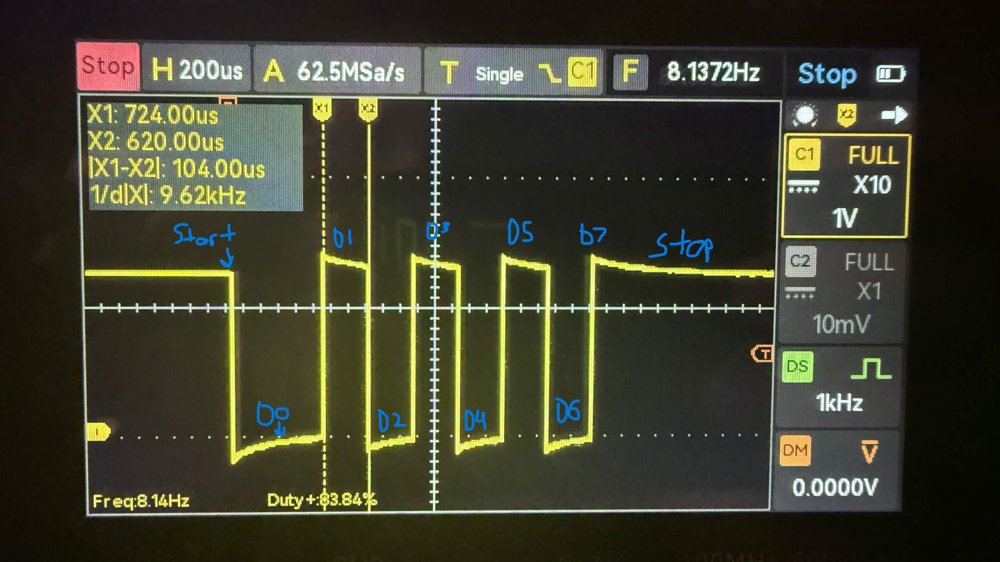
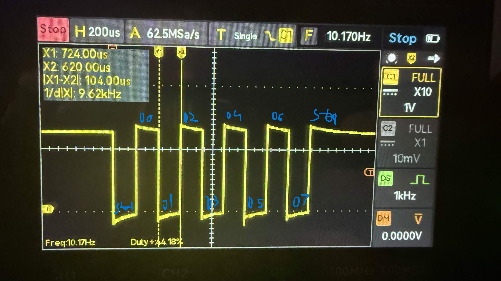
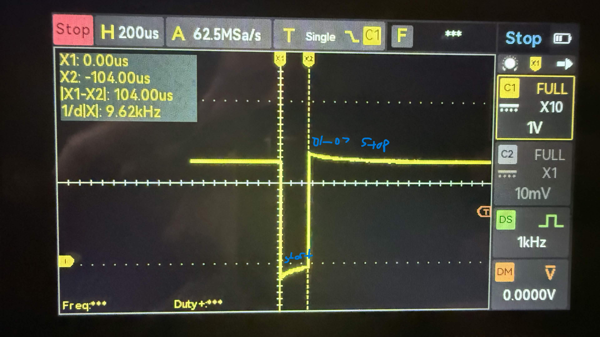
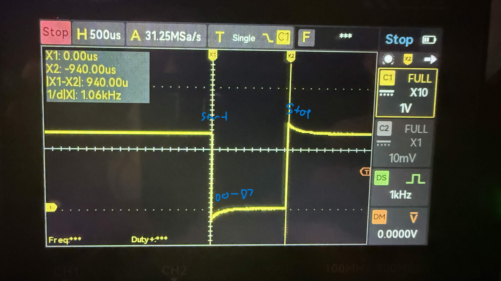
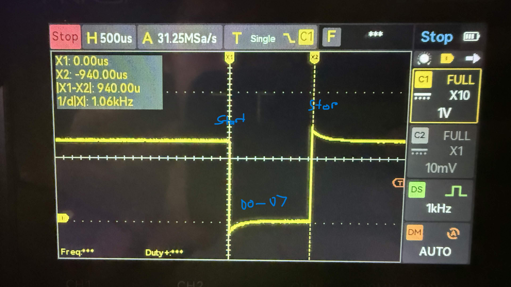
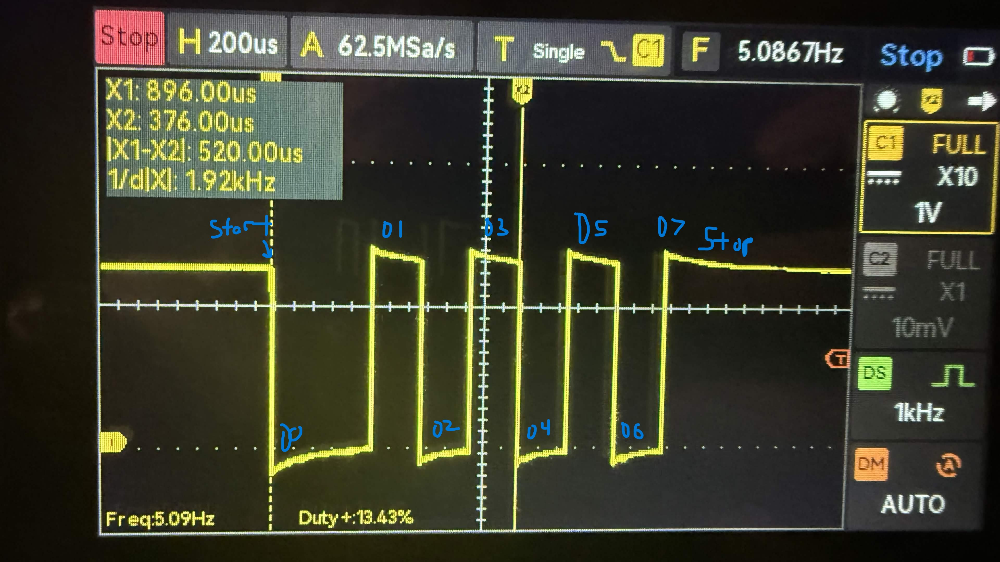
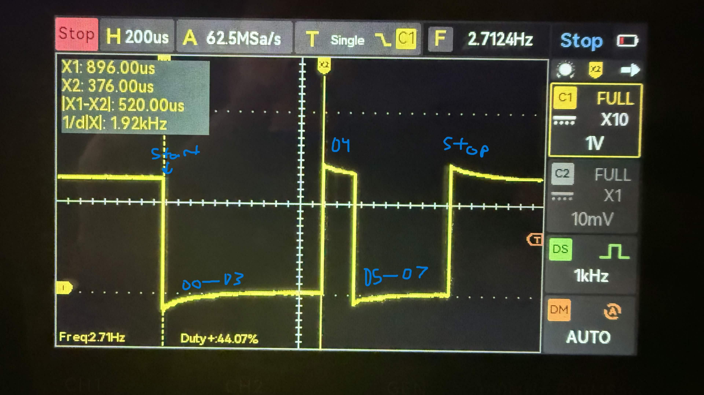
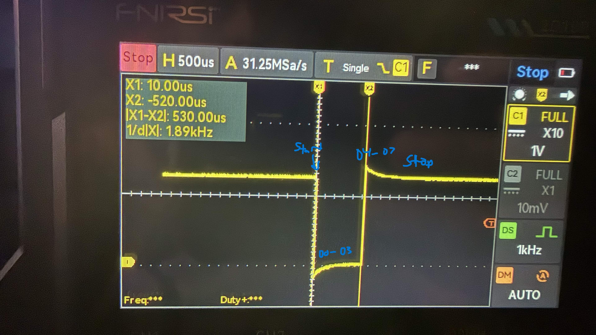
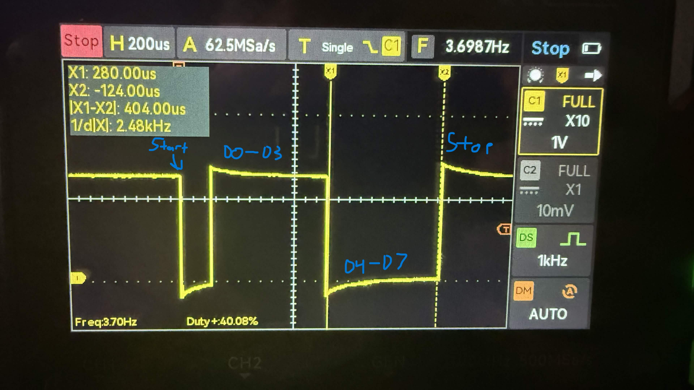

# ECE 528/L - Robotics and Embedded Systems with Lab
**CSU Northridge**

**Department of Electrical and Computer Engineering**

## Bluetooth Low Energy (BLE) Lab
The Bluetooth Low Energy (BLE) lab interfaces with the following:

* User LEDs of the TI MSP432 LaunchPad
* Pololu Gearmotor with Encoder - [Product Link](https://www.pololu.com/product/3675)
* Adafruit Bluefruit LE UART Friend - Bluetooth Low Energy (BLE) Module - [Product Link](https://www.adafruit.com/product/2479)

## Pre-Lab Assignments

### Question 1: Bluetooth Low Energy (BLE)

What is Bluetooth Low Energy (BLE)? How does it differ from regular Bluetooth in terms of power consumption and range?

Bluetooth Low Energy allows devices that require low power consumption while exchanging small amounts of data. It differs by becoming inactive between data transmissions. The range depends on factos such as transmission power, hardware, and environment.

### Question 2: Generic Access Profile (GAP)

What does GAP stand for and what is its purpose? What is the difference between Peripheral and Central devices in the context of BLE?

GAP stands for Generic Access Profile. Its purpose is to manage how BLE devices are discovered and establish wireless connections. A Peripheral device advertises its availability and waits for a connection, while a Central device searches for available peripherals and initiates the connection.

### Question 3: Generic Attribute Profile (GATT)

What is GATT in BLE, and how does it structure data exchange between connected devices? Provide definitions for the following: Profile, Service, and Characteristic.

Generic Attribute Profile (GATT) in BLE defines how two connected Bluetooth Low Energy devices transfer data back and forth.

Profile: A collection of services that describes how a device performs an application or function.

Service: A group of related characteristics that provides a specific function, such as monitoring battery status.

Characteristic: An individual data value within a service that can be read, written, or used to send notifications.

### Question 4: BLE Advertising Packets

What is an advertising packet in BLE and what information can it contain?

An advertising packet is a small wireless message broadcast by a BLE device to announce its presence to nearby devices. It can contain a device name, service UUIDs, manufacturer-specific data, flags, and transmit power.

### Question 5: Universally Unique Identifier (UUID)

What is a UUID used for in BLE and why are 128-bit UUIDs used?

UUID stands for Universally Unique Identifier, and it is used in BLE to identify services and characteristics. 128-bit UUIDs are used for custom services and characteristics created by developers and manufacturers because they provide a larger number of unique identifiers, reducing the possibility of conflicts.

### Question 6: UART Bit Order

What bit from which register determines if the UART data is received or transmitted MSB or LSB first?

Refer to Section 24.4 of the MSP432P4xx Technical Reference Manual (SLAU356I).

Bit 13 in the UCAxCTLW0 register determines whether UART data is transmitted or received MSB-first or LSB-first. Clearing the bit selects LSB-first, while setting the bit selects MSB-first.

### Question 7: MSP432 Pin Functions

Provide the mnemonic and primary module function for each pin listed.

Refer to Table 6-45 (Default Mapping) on page 126 of the MSP432P401R Datasheet.

| Pin  | Mnemonic   | Input Pin Primary Function        | Output Pin Primary Function |
|---|---|---|---|
| P2.2 | PM_UCA1RXD | eUSCI_A1 UART RXD (Receive Data)  | None |
| P2.3 | PM_UCA1TXD | eUSCI_A1 UART TXD (Transmit Data) | None |
| P3.2 | PM_UCA2RXD | eUSCI_A2 UART RXD (Receive Data)  | None |
| P3.3 | PM_UCA2TXD | eUSCI_A2 UART TXD (Transmit Data) | None |


### Question 8: GPIO Primary Function Initialization

Write a `void` function named `P2_2_and_P2_3_Init()` that takes no arguments and configures pins P2.2 and P2.3 to use primary function mode.

It is not necessary to configure the direction of the pins.

Implementation:

```c
void P2_2_and_P2_3_Init(void)
{
    P2->SEL0 |= 0x0C;
    P2->SEL1 &= ~0x0C;
}
```
## Lab 4 Tasks

### Task 6.1A UART Transmission

The eUSCI_A3 UART module was used to transmit four hexadecimal values.

The UART was configured to operate at 9600 baud with 8 data bits, no parity, and 1 stop bit.

The UART_Transmit_Test() function transmitted the hexadecimal values through P9.7 (Tx), with a 500 ms delay between transmissions.

An oscilloscope was connected to P9.7 and GND to capture the UART signals and measure the bit duration.

The following equation was used:

T_bit = 1 / Baud Rate

T_bit = 1 / 9600 = 104.17 us

| Hexadecimal | Binary | Expected Bit Duration |
|---|---|---|
| `0xAA` | `10101010` | 104.17 us |
| `0x55` | `01010101` | 104.17 us |
| `0xFF` | `11111111` | 104.17 us |
| `0x00` | `00000000` | 104.17 us |

The measured bit lasted approximately 104 us, closely matching the expected value at 9600 baud with the given equation.

##### UART Transmission 0xAA


##### UART Transmission 0x55


##### UART Transmission 0xFF


##### UART Transmission 0x00


#### Oscilloscope Results

The oscilloscope screenshots show the START bit, data bits D0 to D7, STOP bit, and measured bit length for each transmitted hexadecimal value.
---

### Task 6.1B PMOD SWT UART Transmission

For Task 6.1B, the PMOD SWT module was used to control which hexadecimal value was transmitted through UART based on the active switch.

The UART_Switch_Init() function configured P10.0 through P10.3 as GPIO inputs with internal pull-down resistors. The UART_Switch_Transmit_Test() function read the switch states and transmitted the corresponding hexadecimal value through P9.7 (UART TX).

The UART operated at 9600 baud with a 500 ms delay between transmissions like the previous task.

##### All Switches OFF 0x00


##### SW1 ON 0xAA


##### SW2 ON 0x10


##### SW3 ON 0xF0


##### SW4 ON 0x0F


| Switch Configuration | UART Hexadecimal Value |
|---|---|
| SW1 ON | `0xAA` |
| SW2 ON | `0x10` |
| SW3 ON | `0xF0` |
| SW4 ON | `0x0F` |
| All switches OFF | `0x00` |
| Multiple switches ON | `0x00` |

Each switch was tested individually, and the resulting UART signals matched their expected hexadecimal values. When all switches were OFF, the transmitted value was `0x00`.

The measured UART bit duration was approximately 104 µs similar to the previous task.

#### Oscilloscope Results

Five oscilloscope screenshots were captured to demonstrate the UART waveforms for SW1, SW2, SW3, SW4, and all switches OFF.

### Task 6.2  Bluetooth Wireless Motor Control

For Task 6.2, the Adafruit Bluefruit LE UART Friend module was used to wirelessly control the TI-RSLK MAX robot using the Bluefruit app.

The BLE_UART_InPacket() function receives five-byte packets from the Bluetooth Controller. Each packet contains a header, command type, button number, button state, and checksum.

The Decode_Controller_Packet() function processes the received button commands and controls the motors.

The following table shows the directional controls:

| Button | Direction | Motor Duty Cycle |
|---|---|---|
| Up (5) | Forward | 30% |
| Down (6) | Backward | 30% |
| Left (7) | Rotate Left | 30% |
| Right (8) | Rotate Right | 30% |

When a directional button is pressed, the robot moves in the corresponding direction at 30% PWM duty cycle. When the button is released, the `Motor_Stop()` function stops both motors.

The motor PWM period was configured to 15,000 but was set at 30 % which is 4500.


#### Results

The robot successfully responded to the forward, backward, left, and right commands transmitted through Bluetooth. Releasing the directional buttons stopped the motors.

## References 

- https://developerhelp.microchip.com/xwiki/bin/view/applications/ble/introduction/
- https://developerhelp.microchip.com/xwiki/bin/view/applications/ble/introduction/bluetooth-architecture/bluetooth-host-layer/gap/roles/
- https://learn.adafruit.com/introduction-to-bluetooth-low-energy/gap
- https://learn.adafruit.com/introduction-to-bluetooth-low-energy/gatt
- https://www.markdownguide.org/extended-syntax/